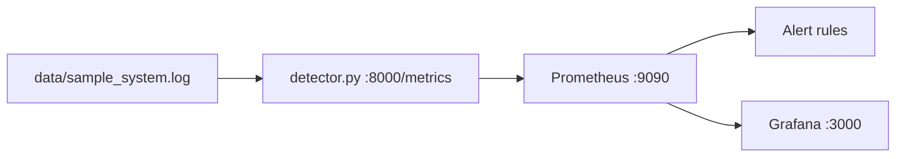

# Advance Log Detector
[](https://github.com/Danishwani1999/Advance_Log_Detector/actions/workflows/ci.yml)

A small log-monitoring stack: a Python service tails a log file, flags windows whose **error rate** crosses a threshold, and exposes Prometheus metrics. Prometheus scrapes it, evaluates alert rules, and Grafana shows a pre-provisioned dashboard. Everything runs with one `docker compose up`.

## How detection works

The detector is **rate-based, not machine learning**. It reads new log lines, and when the file goes idle it evaluates the window it just collected:

- error rate = lines matching `ERROR|CRITICAL|FATAL|EXCEPTION` / total lines in the window
- if the rate is at or above `ERROR_THRESHOLD` (default `0.3`), it increments `anomalies_detected_total` and prints an alert

## Architecture



## Stack

| Component | Version | Role |
|---|---|---|
| Python | 3.11 (slim image) | Log tailing and detection |
| prometheus-client | 0.20.0 | Metrics endpoint |
| Prometheus | v2.47.0 | Scraping and alert rules |
| Grafana | 10.1.0 | Dashboard (auto-provisioned) |
| Docker Compose | v2 | Orchestration |

## Project structure

```
.
├── detector.py                 # tail + detect + expose metrics
├── data/sample_system.log      # demo log (mounted read-only into the container)
├── Dockerfile                  # non-root user, HEALTHCHECK
├── docker-compose.yml
├── prometheus.yml              # scrape config + rule_files
├── alert_rules.yml             # HighLogErrorRate, LogDetectorDown
├── grafana/
│   ├── provisioning/           # datasource + dashboard provider
│   └── dashboards/log-detector.json
└── requirements.txt
```

## Run it

```bash
git clone https://github.com/Danishwani1999/Advance_Log_Detector.git
cd Advance_Log_Detector
docker compose up -d --build
docker compose ps
```

| Service | URL | Notes |
|---|---|---|
| Detector metrics | http://localhost:8000/metrics | |
| Prometheus | http://localhost:9090 | Targets at `/targets`, rules at `/rules` |
| Grafana | http://localhost:3000 | `admin` / `admin` (local demo only) |

## Metrics

| Metric | Type | Meaning |
|---|---|---|
| `logs_processed_total` | Counter | Log lines processed |
| `anomalies_detected_total` | Counter | Windows that crossed the error threshold |
| `log_error_rate` | Gauge | Error share of the last window (0.0 to 1.0) |

## Alert rules

- `HighLogErrorRate`: `log_error_rate >= 0.3`
- `LogDetectorDown`: the scrape target has been down for 1 minute

## Demo: trigger an anomaly

The container starts by reading the 32-line sample file from the top (`READ_FROM_START=true`). Baseline:

```
logs_processed_total 32.0
anomalies_detected_total 0.0
log_error_rate 0.09375          # 3 errors / 32 lines
```

Append an error burst:

```bash
for i in 1 2 3 4 5; do echo "$(date '+%F %T') [ERROR] Simulated failure $i" >> data/sample_system.log; done
echo "$(date '+%F %T') [INFO] Request processed successfully" >> data/sample_system.log
docker compose logs --tail=3 detector
curl -s localhost:8000/metrics | grep -E "^(logs_processed_total|anomalies_detected_total|log_error_rate)"
```

Observed result:

```
[ALERT] Error spike detected! Window rate: 0.83
logs_processed_total 38.0
anomalies_detected_total 1.0
log_error_rate 0.8333333333333334   # 5 errors / 6 new lines
```

Reset the sample file afterwards with `git checkout -- data/sample_system.log`.

## Configuration

| Variable | Default | Purpose |
|---|---|---|
| `LOG_FILE_PATH` | `sample_system.log` | File to tail (`/data/sample_system.log` in Compose) |
| `ERROR_THRESHOLD` | `0.3` | Error rate that counts as an anomaly |
| `READ_FROM_START` | `false` | Read the existing file instead of only new lines |

## Limitations and next steps

- Detection is a fixed error-rate threshold. There is no learned baseline or seasonality handling.
- `log_error_rate` keeps its last value while the log is idle, so an alert can keep firing. A decay to 0 after an idle timeout would fix this.
- The detector does not follow log rotation.
- No Alertmanager yet, so alerts are visible in Prometheus but not sent anywhere.
- Prometheus data is not persisted across `docker compose down -v`.
- No automated tests or CI yet.
- Grafana uses default credentials, which is fine for a local demo only.

## Author

Danish Wani, fresher DevOps and cloud engineer. GitHub: [@Danishwani1999](https://github.com/Danishwani1999)

Licensed under the MIT License.
