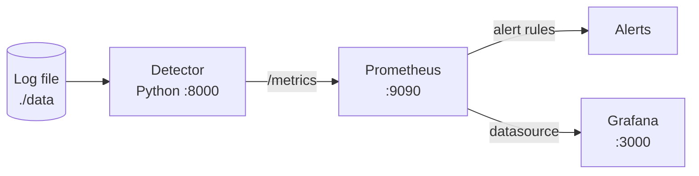

# Advance Log Detector

Log error-rate detection exposed as Prometheus metrics, with a provisioned Grafana dashboard and alert rules. The whole stack runs with one `docker compose` command.


---

## Overview

Applications and servers produce far more log lines than anyone can read. This project turns a log file into signals that existing monitoring tools understand:

1. A Python service reads log lines and flags anomalous events (error-rate based).
2. The service exposes counters and gauges at `/metrics`.
3. Prometheus scrapes the metrics and evaluates alert rules.
4. Grafana shows the results on a dashboard that is provisioned from code, with no manual setup.

It is a small, self-contained example of treating logs as metrics and managing the monitoring stack as code.

## Architecture



| Service | Image / Build | Port | Role |
|---|---|---|---|
| `detector` | Built from `Dockerfile` | 8000 | Parses logs, detects anomalies, exports metrics |
| `prometheus` | `prom/prometheus:v2.47.0` | 9090 | Scrapes metrics, evaluates `alert_rules.yml` |
| `grafana` | `grafana/grafana:10.1.0` | 3000 | Dashboards, provisioned from `grafana/` |

## Repository structure

```text
Advance_Log_Detector/
├── detector.py            # Log parsing and anomaly detection logic
├── exporter.py            # Runs the detector and exposes Prometheus metrics
├── Dockerfile             # Detector image
├── docker-compose.yml     # Full stack: detector + Prometheus + Grafana
├── prometheus.yml         # Scrape configuration
├── alert_rules.yml        # Prometheus alert rules
├── grafana/
│   ├── provisioning/      # Datasource and dashboard provider config
│   └── dashboards/        # Dashboard JSON
├── data/                  # Sample log input (mounted read-only)
├── requirements.txt
└── README.md
```

## Project Structure

Advance_Log_Detector/
├── assets/
├── data/
├── grafana/
├── models/
├── scripts/
├── src/
├── tests/
├── Dockerfile
├── LICENSE
├── README.md
├── alert_rules.yml
├── detector.py
├── docker-compose.yml
├── prometheus.yml
├── pytest.ini
└── requirements.txt

## Getting started

### Prerequisites

- Docker Engine and Docker Compose v2
- Git

```bash
docker --version
docker compose version
```

### Run

```bash
git clone https://github.com/Danishwani1999/Advance_Log_Detector.git
cd Advance_Log_Detector
docker compose up -d --build
docker compose ps
```

### Endpoints

| URL | What you get |
|---|---|
| http://localhost:8000/metrics | Raw application metrics |
| http://localhost:9090 | Prometheus UI (`/targets`, `/alerts`) |
| http://localhost:3000 | Grafana (dashboard is preloaded) |

> **Security:** Grafana ships with default credentials. Change them, or set `GF_SECURITY_ADMIN_PASSWORD` in `docker-compose.yml`, before exposing the port beyond localhost.

## Configuration

The detector is configured with environment variables in `docker-compose.yml`:

| Variable | Default | Description |
|---|---|---|
| `LOG_FILE_PATH` | `/data/sample_system.log` | Log file to process |
| `ERROR_THRESHOLD` | `0.3` | Error ratio above which an anomaly is flagged |
| `READ_FROM_START` | `true` | Process the file from the beginning instead of only new lines |

## How detection works

The detector reads each log line, classifies its severity, and tracks the ratio of error-level lines. When that ratio goes above `ERROR_THRESHOLD`, the event is counted as an anomaly and the anomaly metric is incremented.

## Detection Logic

The detector processes log streams using a configurable sliding time window (e.g., 60 seconds). It parses incoming log entries, searches for error signatures or anomaly patterns using the core components in `detector.py` and any pre-trained weights from `models/`, and increments an error counter whenever a threshold is crossed.

## Metrics

| Metric | Type | Description |
|---|---|---|
| `logs_processed_total` | Counter | Log lines processed |
| `log_anomalies_total` | Counter | Anomalous events detected |
| `latest_anomaly_score` | Gauge | Score of the most recent entry |

## Prometheus Metrics

The application exposes metrics on `http://localhost:8000/metrics`:

* **`log_errors_total`** (Counter): Total number of log errors detected since startup.
* **`log_error_rate_per_minute`** (Gauge): Current error frequency calculated within the active sliding window.

## Try it

Append an error line to the sample log and watch the metrics change:

```bash
echo "$(date '+%F %T') ERROR Disk failure detected" >> data/sample_system.log
curl -s localhost:8000/metrics | grep -E "logs_processed_total|log_anomalies_total"
```

Then check **Prometheus → Alerts** and the Grafana dashboard.

## Verifying the stack

```bash
docker compose ps                                   # all services Up
curl -s localhost:9090/-/healthy                    # Prometheus health
curl -s localhost:9090/api/v1/targets | grep -o '"health":"[a-z]*"'   # scrape target UP
docker compose logs -f detector                     # detector output
```

<!-- Add a Grafana dashboard screenshot here: docs/dashboard.png -->

## Troubleshooting

| Symptom | Fix |
|---|---|
| Port already in use | `sudo lsof -i :9090` (or `:3000`, `:8000`), stop the process, rerun |
| Target shows DOWN | Check `docker compose logs detector` and the target name in `prometheus.yml` |
| Empty dashboard | Confirm the Prometheus datasource is healthy in Grafana |

## Known limitations

- Single log file, single format.
- Prometheus data is not persisted across `docker compose down -v`.
- Alerts are evaluated by Prometheus only. No notification channel (Alertmanager) is configured yet.
- No automated tests or CI pipeline yet.

## Roadmap

- [ ] Unit tests for the detector, run in GitHub Actions
- [ ] CI: lint, `docker build`, `docker compose config`, image scan with Trivy
- [ ] Alertmanager with a notification receiver
- [ ] Persistent volumes for Prometheus and Grafana
- [ ] Container healthchecks and a non-root runtime user
- [ ] Multiple log formats and files

## Author

**Danish Wani** · Fresher DevOps & Cloud Engineer
GitHub: [@Danishwani1999](https://github.com/Danishwani1999)

## License

MIT. See [LICENSE](LICENSE).
