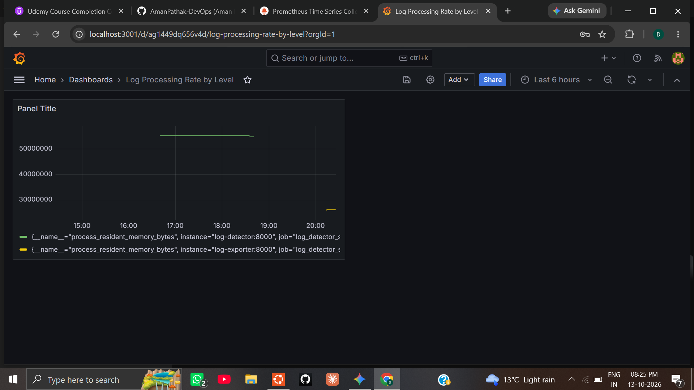
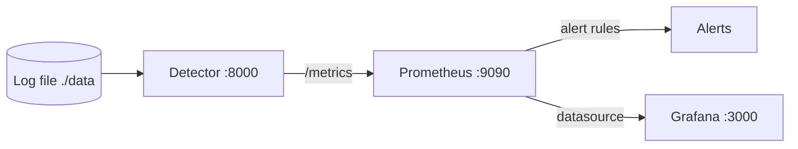

# Advance Log Detector

Log error-rate detection exposed as Prometheus metrics, with a provisioned Grafana dashboard and alert rules. The whole stack runs with one `docker compose` command.





## Architecture



## Repository structure

```text
├── detector.py            # Tails the log, computes error rate, exports metrics
├── Dockerfile             # Non-root image with healthcheck
├── docker-compose.yml     # detector + Prometheus + Grafana
├── prometheus.yml         # Scrape config
├── alert_rules.yml        # HighLogErrorRate, LogDetectorDown
├── grafana/               # Provisioned datasource and dashboard
├── data/                  # Sample log (mounted read-only)
├── tests/                 # pytest unit tests
└── .github/workflows/     # CI: lint, tests, config validation, smoke test
```

## Run

```bash
docker compose up -d --build
```

| URL | What |
|---|---|
| http://localhost:8000/metrics | Raw metrics |
| http://localhost:9090 | Prometheus |
| http://localhost:3000 | Grafana (set `GF_SECURITY_ADMIN_PASSWORD` in a `.env` file) |

## Configuration

| Variable | Default | Description |
|---|---|---|
| `LOG_FILE_PATH` | `/data/sample_system.log` | Log file to read |
| `ERROR_THRESHOLD` | `0.3` | Error ratio that counts as an anomaly |
| `READ_FROM_START` | `true` | Read from the start instead of only new lines |

## Metrics

| Metric | Type | Description |
|---|---|---|
| `logs_processed_total` | Counter | Log lines processed |
| `anomalies_detected_total` | Counter | Windows whose error rate crossed the threshold |
| `log_error_rate` | Gauge | Error share (0.0 to 1.0) of the last processed window |

A window is the batch of lines read between polls, not a fixed time period.

## Try it

```bash
echo "$(date '+%F %T') [ERROR] Disk failure" >> data/sample_system.log
curl -s localhost:8000/metrics | grep -E "logs_processed_total|anomalies_detected_total"
```

## CI

GitHub Actions runs flake8, pytest, `docker compose config`, dashboard JSON validation, `promtool check rules`, and a smoke test of the full stack.

## Known limitations

- Single log file and format; no log-rotation handling.
- No Alertmanager receiver and no persistent volumes for Prometheus or Grafana.

## License

MIT
